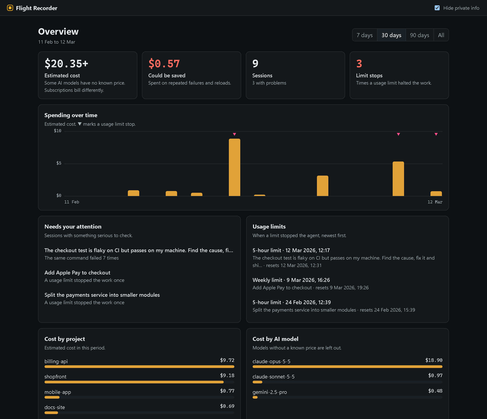
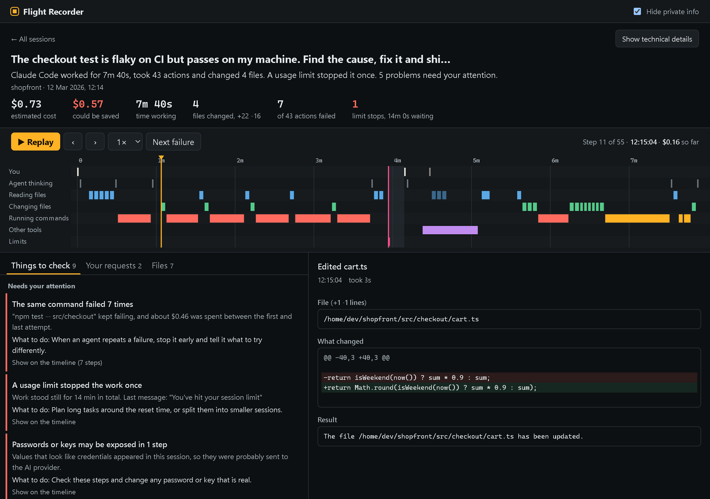

<h1 align="center">Agent Flight Recorder</h1>

<p align="center"><strong>The black box for AI coding agents.</strong><br>
Replay any Claude Code, Codex or Gemini CLI session on a timeline. See what it did, what it cost, which limits it hit and where it went wrong.</p>

<p align="center">
  <a href="https://github.com/Kenan0z/agent-flight-recorder/actions/workflows/ci.yml"></a>
  <a href="LICENSE"></a>
  
  
</p>

<p align="center">Runs on your machine · No account or API key · Works on the sessions you already have</p>

<p align="center"></p>

## Try it in one minute

You need [Node.js 22 or newer](https://nodejs.org). Start with the invented demo sessions:

```bash
npx github:Kenan0z/agent-flight-recorder --demo
```

Then open your own sessions:

```bash
npx github:Kenan0z/agent-flight-recorder
```

Your browser opens by itself. There is nothing to configure or instrument, because Flight Recorder reads the logs your agents already write. That includes sessions from before you installed it. Press `Ctrl+C` in the terminal to stop.

<details>
<summary>Install from source instead</summary>

```bash
git clone https://github.com/Kenan0z/agent-flight-recorder.git
```

```bash
cd agent-flight-recorder
```

```bash
npm install
```

```bash
npm link
```

```bash
flightrec --demo
```

</details>

## Why you might want this

An agent just spent 40 minutes and $12 on your repo. The diff looks fine. But:

- Did it run the tests on the final code, or only before its last edit?
- Why did that one session cost five times as much as the others?
- Did it force-push, delete something, or read your `.env`?
- When did it hit your usage limit, and how long did the work stand still?
- Was it making progress, or running the same failing command again and again?

The answers are in the session logs, buried in megabytes of JSON. Flight Recorder turns them into something you can read in a minute, even if you have never looked at a token count.

## A quick tour

### Overview

The first screen answers "how is my AI usage going?" for the last 7, 30 or 90 days or for all time:

- **Four headline numbers:** estimated cost, what could have been saved, number of sessions and limit stops.
- **Spending over time:** a daily chart, with the days a usage limit stopped you marked.
- **Needs your attention:** sessions with something serious to check, and why.
- **Usage limits:** when each limit hit and when it resets.
- **Cost by project and by AI model.**
- **All sessions:** searchable, each with a plain status.

### Session replay

Open a session and one sentence tells you what happened. Below it, a timeline shows what the agent was doing and when: reading, changing files, running commands, or waiting on a limit. Press **Replay**, step with the arrow keys, or click anything on the timeline to see that exact step, including file changes and command output.

<p align="center"></p>

Long pauses are collapsed so they don't flatten the rest of the timeline. Failed actions are red.

**Show technical details** adds what developers want: token counts, a searchable list of every step, a chart of working memory and cost, per-tool statistics and more timeline rows.

### Things to check

Every finding says what happened and what to do about it. Clicking one takes you to the exact steps behind it.

| Finding | What it catches |
| --- | --- |
| Limit stops | A usage limit halting the work, how long it stalled and whether the session ended there |
| Too many requests | 429 and overload errors, keeping provider capacity problems separate from your account |
| Close to a limit | 80% or more of a limit window used, where the agent logs it (currently Codex) |
| Possible secrets | Values that look like credentials in prompts or tool data, which were probably sent to the AI provider |
| Risky actions | Force pushes, recursive deletes, `curl \| sh`, skipped git hooks, destructive SQL, reads of `.env` and private keys |
| Repeated failures | The same command failing again and again, with what was spent meanwhile |
| Reloads | A pause outliving the prompt cache, with what reloading the conversation cost |
| Unverified changes | Code changed after the last test or build, or with none at all |
| Failure streaks | Five or more actions failing in a row |
| Repeated reads | The same unchanged file loaded three or more times |
| Heavily edited files | Files edited ten or more times |
| Expensive requests | One request using over half of a session's cost |

These are rules of thumb and not verdicts. A force push may be exactly what you asked for, so a finding means "look at this", not "this was wrong".

### Shareable reports

Export a session as one HTML file, with secrets and personal data masked. The recipient needs no server and no install, so you can attach it to a pull request or send it to a teammate.

```bash
flightrec export latest -o report.html
```

[`docs/demo.html`](docs/demo.html) is an example. Download it and open it in a browser. Masking is best effort, so read a report before you share it.

## Supported agents

| Agent | Logs read from | Limits shown | Status |
| --- | --- | --- | --- |
| Claude Code | `~/.claude/projects`, including subagents | Stops, limit type, reset time | Tested against real sessions |
| OpenAI Codex CLI | `~/.codex/sessions` | Stops, errors, % used per window | Early: tested against hand-written samples |
| Gemini CLI | `~/.gemini/tmp`, including subagents | Stops and errors, from their wording | Early: written from its source code, tested against hand-written samples |

**Early** support may misread things, so please [open an issue](https://github.com/Kenan0z/agent-flight-recorder/issues) if something looks wrong. Claude Code and Gemini CLI logs do not record how much of a limit is left, so Flight Recorder shows when a limit was hit rather than inventing a percentage.

**Antigravity** is not supported yet. Community reverse-engineering describes undocumented protobuf data whose layout has changed between versions, so a parser written today would be guesswork.

Want another agent? It takes one parser that turns its logs into a list of events. See [CONTRIBUTING.md](CONTRIBUTING.md).

## Commands

```text
flightrec                     Open the overview and replay UI
flightrec list                List recorded sessions
flightrec report [session]    Print a summary and findings
flightrec export [session]    Write a shareable HTML file
```

`[session]` is `latest` (the default) or the start of a session id, as shown by `flightrec list`.

| Option | Purpose |
| --- | --- |
| `--demo` | Use the bundled demo sessions instead of your logs |
| `--dir <path>` | Also read logs from a folder or file (repeatable) |
| `--prices <file>` | JSON price table, merged over the built-in one |
| `--json` | Machine-readable output for `list` and `report` |
| `--port <n>` | UI port. The default is 4173, trying the next ones if it is busy |
| `--no-open` | Do not open a browser |
| `--no-cache` | Re-read every log |
| `-o, --out <file>` | Export path |
| `--no-redact` | Keep secrets and personal data in an export |
| `-h, --help` | Show help |
| `-v, --version` | Show the version |

| Environment variable | Purpose |
| --- | --- |
| `CLAUDE_CONFIG_DIR` | Claude Code folder, instead of `~/.claude` |
| `CODEX_HOME` | Codex folder, instead of `~/.codex` |
| `GEMINI_CLI_HOME` | Folder containing `.gemini`, instead of your home folder |
| `XDG_CACHE_HOME` | Where the session index is stored, instead of `~/.cache` |
| `NO_COLOR` | Turn off terminal colors |

### Keyboard shortcuts

| Key | Action |
| --- | --- |
| `Space` | Play or pause |
| `←` `→` | Previous or next step |
| `Home` `End` | First or last step |
| `E` | Next failed action |
| `+` `-` `0` | Zoom in, zoom out, fit the whole session |
| `/` | Search steps (technical details view) |
| `Ctrl` + scroll, drag | Zoom and move the timeline |

Adding `@12` to the end of a session link opens it at step 12.

### Use it in scripts

`--json` makes it easy to build checks. For example, with [jq](https://jqlang.org), list the serious findings in your latest session:

```bash
flightrec report latest --json | jq '.findings[] | select(.severity == "high") | .title'
```

Or list the sessions that were stopped by a limit:

```bash
flightrec list --json | jq '.[] | select(.limitHits > 0) | .title'
```

## Privacy and security

Your transcripts may contain code, secrets and private conversations, so the tool is built around that:

- **Nothing leaves your machine.** No telemetry, no accounts and no network calls of its own.
- **No runtime dependencies**, so there is no third-party code to audit at runtime.
- **Read-only.** Logs are never changed. Apart from your exports, the only file written is a small index of session summaries in `~/.cache/agent-flightrec`.
- **Local server only.** The UI binds to `127.0.0.1`, rejects requests with a foreign `Host` header (which blocks DNS rebinding) and sends no CORS headers.
- **Transcript text stays text.** It is never rendered as HTML, so a malicious file an agent read cannot run scripts in the page.
- **Locked-down exports.** Reports carry a Content Security Policy that blocks all network access.

**Masking is best effort.** "Hide private info" is on by default. It uses pattern matching for common credential formats, emails, your home folder, user name and host name. It can miss things, and the session index stores unmasked titles on your own disk.

Found a security problem? Please report it privately through GitHub's [security advisories](https://github.com/Kenan0z/agent-flight-recorder/security/advisories/new) rather than in a public issue.

## How accurate is the cost?

Costs are **estimates at first-party API rates**, computed per response from logged token counts, including cache reads, 5-minute and 1-hour cache writes, and fast mode. On one real Claude Code session, the calculation matched the total Claude Code recorded to within 0.01%.

Keep in mind:

- **Subscriptions, free tiers and cloud platforms bill differently.** Read the figure as "what this would cost on the API".
- **Prices change.** The built-in table was checked in October 2026, and some Gemini rates are limited-time offers.
- **Codex models have no built-in price yet.** They show as `n/a` or with a `+` after the total rather than a guess.
- **"Could be saved" is a rule of thumb:** what a session spent during repeated failures plus the extra paid for reloads. It is not a precise refund.

You can add or override rates with `--prices`. Values are USD per million tokens, and a key matches any model id that starts with it:

```json
{
  "my-model": { "input": 3, "output": 15, "cacheRead": 0.3 }
}
```

```bash
flightrec --prices prices.json
```

## Troubleshooting

**"No sessions found".** Use a supported agent at least once, or check that its logs are in the location listed above. If you moved them, point to them with `--dir` or the environment variables.

**The numbers look out of date.** Run with `--no-cache` to read every log again.

**The port is busy.** The default port tries the next ones automatically. With `--port` it stops with an error instead, so pick another.

**The browser didn't open.** Open the address printed in the terminal, or use `--no-open` on purpose when working over SSH. The server only listens locally, so forward the port to reach it from another machine.

**A session looks wrong.** Log formats change without notice. Please open an issue describing the record's shape, and never paste a real transcript.

## How it works

```text
agent logs -> parser -> list of events -> analysis -> web UI, HTML export or terminal report
```

Each agent has a parser that streams its logs line by line, so files of hundreds of MB stay out of memory, and tolerates unknown or half-written records. Everything after that works on one shared event format. The UI is plain HTML, CSS and JavaScript with no build step or framework, drawn on a canvas so sessions with thousands of steps stay smooth.

## Roadmap

Ideas, in no fixed order:

- Live monitoring that warns while an agent is looping
- Comparing two sessions side by side
- A `check` command for CI that fails above a cost or on serious findings
- Linking sessions to the commits they produced
- More agents, including Antigravity once its format can be read reliably
- Translated interfaces

Which would help you most? [Open an issue](https://github.com/Kenan0z/agent-flight-recorder/issues) and say so.

## Contributing

Bug reports and pull requests are welcome, especially parsers for new agents and samples of log shapes that break. See [CONTRIBUTING.md](CONTRIBUTING.md).

```bash
npm install
```

```bash
npm test
```

```bash
npm run demo
```

## License

[MIT](LICENSE). Use it for anything, including commercial work.

Agent Flight Recorder is an independent project and is not affiliated with Anthropic, OpenAI or Google.
